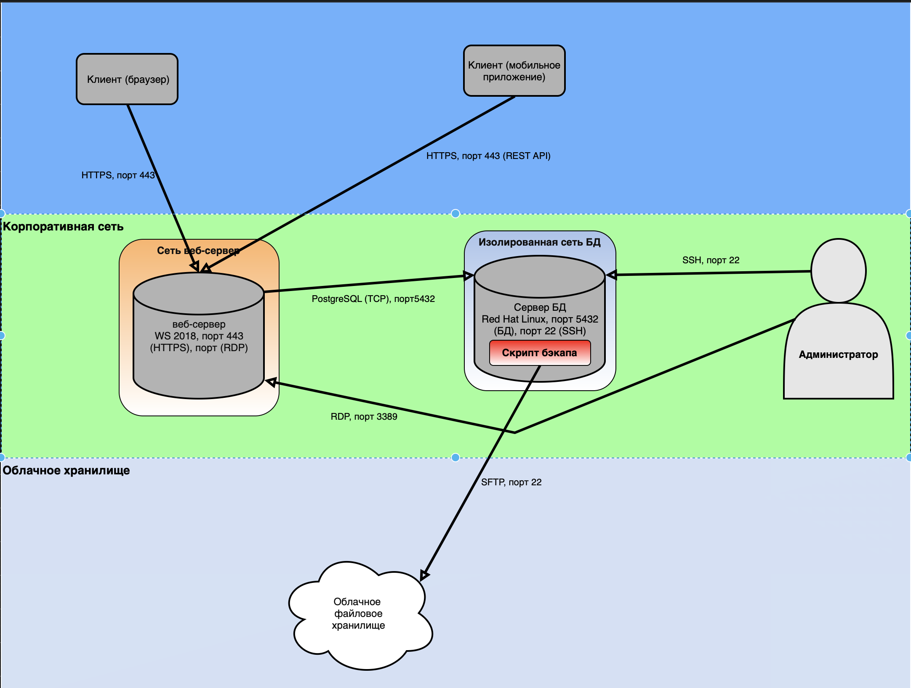

# Практическая работа: Классификация БД и инфраструктурная схема

## 🎯 Цель работы
Закрепить понимание классификаций БД и принципов взаимодействия инфраструктуры с БД.

## 📋 Задание
1. Определить признаки классификации для шести СУБД: Oracle RDBMS, HBase, ClickHouse, SQLite, MongoDB, MsSQL.
2. Отрисовать инфраструктурную схему взаимодействия с БД по описанию.
3. Предположить, какая СУБД используется.
4. Найти элемент, требующий улучшения безопасности.

## 🛠️ Использованные инструменты
- Draw.io / diagrams.net — для схемы
- Word — для оформления решения
- Знания по классификации СУБД

---

## 📸 Задание 1. Классификация БД

Признаки классификации:
- По способу хранения: серверная / файловая / распределённая / колоночная / документо-ориентированная.
- По доступу пользователей: однопользовательская / многопользовательская.
- По расположению: on-premise / cloud / встраиваемая / локальная.
- По типу нагрузки: OLTP / OLAP / HTAP.

### Таблица классификации

| СУБД | Способ хранения | Доступ пользователей | Расположение | Тип нагрузки |
|------|-----------------|----------------------|--------------|--------------|
| Oracle RDBMS | Серверная (реляционная) | Многопользовательская | on-premise / cloud | OLTP (возможен OLAP с доп. модулями) |
| HBase | Серверная (распределённая, NoSQL) | Многопользовательская | on-premise / cloud | OLTP (NoSQL, работа с большими данными) |
| ClickHouse | Серверная (колоночная) | Многопользовательская | on-premise / cloud | OLAP (аналитика) |
| SQLite | Файловая (однофайловая) | Однопользовательская (или многопоточная, без сетевых соединений) | Локальная (встраиваемая) | OLTP (лёгкая, встроенная) |
| MongoDB | Серверная (документо-ориентированная, NoSQL) | Многопользовательская | on-premise / cloud | OLTP (гибкая схема) |
| MsSQL | Серверная (реляционная) | Многопользовательская | on-premise / cloud | OLTP (возможен OLAP) |

Пояснения:
- Oracle RDBMS — классическая реляционная СУБД, используется в крупных корпоративных системах для транзакционной нагрузки (OLTP).
- HBase — распределённая NoSQL-СУБД, работает поверх HDFS, подходит для больших объёмов данных.
- ClickHouse — колоночная СУБД, оптимизирована для аналитических запросов (OLAP).
- SQLite — встраиваемая СУБД в одном файле, не поддерживает сетевые подключения, используется в мобильных и desktop-приложениях.
- MongoDB — документо-ориентированная NoSQL-СУБД с гибкой схемой.
- MsSQL — реляционная СУБД от Microsoft, для транзакционных и аналитических задач.

---

## 📸 Задание 2. Инфраструктурная схема взаимодействия с БД

### Исходные данные

- Web-сервис: отдельный сервер, Windows Server 2018, антивирус Касперского, доступ по HTTPS (443).
- Клиенты: браузер (https://skillbox.ru) и мобильное приложение через REST API (HTTPS, 443).
- БД: отдельный сервер, Red Hat Linux, порты 5432 и 22, внутренний IP 192.168.0.45.
- Администратор: подключается к БД по SSH (из внутренней сети) и к web-серверу по RDP.
- Персональные данные: ФИО, паспорт, фото пользователя.
- Резервные копии: хранятся в облачном файловом хранилище, копирование по SFTP.
- Отказоустойчивость: низкие требования, долгий простой допустим.
- Размещение БД: выделенная область корпоративной сети, взаимодействует только с web-сервером.

### Схема

### Описание схемы

| Компонент | Роль | Что делает |
|-----------|------|------------|
| Клиент (браузер) | Пользователь | Заходит на https://skillbox.ru, HTTPS порт 443 |
| Клиент (мобильное приложение) | Пользователь | Взаимодействует с web-сервером через REST API, HTTPS порт 443 |
| Web-сервер | Промежуточное звено | Windows Server 2018, Kaspersky, принимает запросы от клиентов, обращается к БД по порту 5432 |
| Сервер БД | Хранилище | Red Hat Linux, PostgreSQL (порт 5432), SSH (порт 22), IP 192.168.0.45 |
| Администратор | Управление | SSH к БД (из внутреннего сегмента), RDP к web-серверу |
| Облачное файловое хранилище | Резервное копирование | Принимает бэкапы БД по SFTP |

### Определение СУБД

СУБД: PostgreSQL.

Определено по порту 5432 — это стандартный порт PostgreSQL. Дополнительно это подтверждается:
- Операционная система Red Hat Linux (типична для PostgreSQL).
- Наличие порта 22 (SSH) для администрирования.
- Соединение только с web-сервером (классическая архитектура веб-приложения).

### Выявленная уязвимость (отмечена красным)

Уязвимость: логин и пароль для подключения к БД и облачному хранилищу хранятся в открытом виде в скрипте ежесуточного копирования.

Чем это опасно:
- Скрипт находится на сервере или в репозитории.
- Любой, кто получит доступ к скрипту (через SSH, через уязвимость, через бэкап файловой системы), получит учётные данные.
- Злоумышленник сможет:
  - подключиться к БД и украсть персональные данные (ФИО, паспорт, фото);
  - получить доступ к облачному хранилищу и выкачать все резервные копии;
  - изменить данные в БД без ведома администратора.

Это критическая уязвимость класса CWE-256 (Unprotected Storage of Credentials) и CWE-798 (Use of Hard-coded Credentials).

### Рекомендации по исправлению

1. Не хранить пароли в коде скрипта. Использовать переменные окружения:
export DB_PASSWORD=...
export CLOUD_PASSWORD=...

2. Ограничить доступ к файлам конфигурации. Права 600 (только владелец).

3. Использовать менеджер секретов (HashiCorp Vault, AWS Secrets Manager) — выдаёт пароли по запросу через защищённый API.

4. Ротация паролей — менять пароли регулярно.

5. Аудит доступа к скриптам копирования и учётным данным.

---

## 📊 Выводы
- Освоена классификация шести популярных СУБД по четырём признакам: способ хранения, доступ пользователей, расположение, тип нагрузки.
- Определена СУБД по порту (5432 → PostgreSQL).
- Отработано построение инфраструктурной схемы взаимодействия клиентов, web-сервера, БД, администратора и облачного хранилища.
- Выявлена критическая уязвимость — хранение учётных данных в открытом виде в скрипте.
- Предложены меры по устранению уязвимости.

## 🧠 Чему научился
- Классификация СУБД по признакам.
- Различия между реляционными, NoSQL, колоночными и встраиваемыми БД.
- Понимание OLTP и OLAP-нагрузок.
- Определение СУБД по сетевому порту.
- Построение инфраструктурной схемы взаимодействия с БД.
- Поиск уязвимостей в описании инфраструктуры.
- Понимание рисков хранения учётных данных в открытом виде.

## 🔐 Практическая значимость
Навыки классификации БД и анализа инфраструктуры — базовые для специалиста по ИБ:
- понимание, какая СУБД подходит под задачу;
- анализ архитектуры приложений и выявление слабых мест;
- выявление критических уязвимостей (хранение паролей в коде, отсутствие шифрования);
- разработка рекомендаций по защите данных.

В реальной работе эти навыки применяются при аудите инфраструктуры, анализе защищённости приложений и оценке рисков обработки персональных данных.
